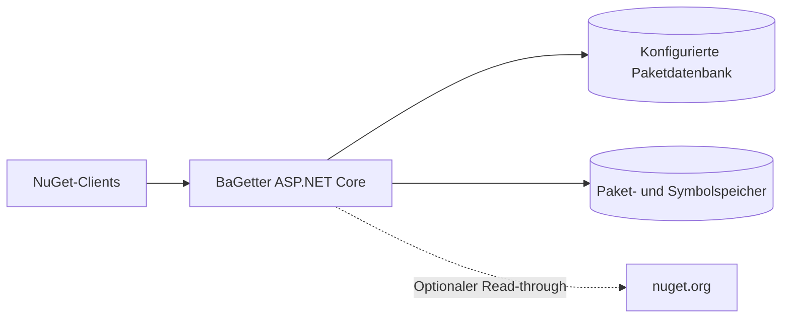

# BaGetter — Cenn0-Fork

**Sprache:** [English](readme.md) · **Deutsch**

[](https://github.com/Cenn0/BaGetter/actions/workflows/main.yml)
[](LICENSE)

**Direkt zu:** [Schnellstart](#schnellstart) · [Funktionsumfang](#funktionsumfang) · [Mirror-Anleitung](docs/MIRROR.md) · [Dokumentation](docs/INDEX.md) · [Roadmap](ROADMAP.md)

Ein selbst gehosteter **NuGet-V3-Paket- und Symbolserver** auf Basis von C# und ASP.NET Core. Dieses Repository ist ein eigenständig gepflegter Fork von [BaGetter](https://github.com/bagetter/BaGetter), das ursprünglich aus [BaGet](https://github.com/loic-sharma/BaGet) hervorgegangen ist.

> **Projektstatus:** Dieser Fork wird weiterentwickelt. Images und Releases des Upstream-Projekts enthalten **nicht** automatisch die Änderungen dieses Forks. Der optionale Mirror zu nuget.org hat ausgewählte Live-Smoke-Tests bestanden; eine vollständige NuGet-Protokollkompatibilität, Mehrinstanzfähigkeit und Produktionsfreigabe sind damit nicht nachgewiesen.

## Schnellstart

Benötigt wird ein zu [global.json](global.json) kompatibles **.NET-10-SDK**.

```bash
git clone https://github.com/Cenn0/BaGetter.git
cd BaGetter
dotnet restore
dotnet run --project src/BaGetter --urls http://localhost:5000
```

Die Oberfläche ist unter [http://localhost:5000/](http://localhost:5000/) erreichbar. Der NuGet-V3-Feed liegt unter `http://localhost:5000/v3/index.json`.

### Docker

Erstelle das Image **aus diesem Fork**, nicht aus einem Upstream-Image:

```bash
docker build -t bagetter-local:dev .
docker volume create bagetter-data
docker run --rm --name bagetter -p 127.0.0.1:5000:8080 \
  -v bagetter-data:/data bagetter-local:dev
```

Das Volume `/data` enthält Pakete, Symbole und SQLite-Daten. Der Port ist absichtlich nur an Loopback gebunden. Diese Befehle dienen der **lokalen Erprobung**, nicht dem Produktionsbetrieb.

## Funktionsumfang

- NuGet-V3-Paketfeed mit Weboberfläche und Symbol-Endpunkten.
- Konfigurierbare Datenbank- und Speicheranbieter.
- Optionaler **Read-through-Cache** für Pakete von nuget.org.
- .NET-Builds, Unit-/Integrationstests und dedizierte Mirror-Smoke-Tests.

Aktiviere das Read-through-Caching mit den folgenden Umgebungsvariablen in deiner lokalen Installation:

```dotenv
Mirror__Enabled=true
Mirror__PackageSource=https://api.nuget.org/v3/index.json
```

Der Mirror kann angeforderte Paketdaten zwischenspeichern, ist aber **kein vollständig transparenter NuGet-V3-Reverse-Proxy**. Suche, Autovervollständigung, Offline-Metadatenauflösung und Konsistenz über mehrere Instanzen benötigen eigene Prüfungen. Siehe [Mirror-Verhalten und Live-Testnachweise](docs/MIRROR.md).

## Architektur im Überblick



Der Mirror ist optional und **kein vollständiger Such- oder Metadatenproxy**. Siehe [Betrieb und Backups](docs/OPERATIONS.md).

## Entwicklung

```bash
dotnet restore
dotnet build --no-restore
dotnet test --no-build
```

Die [GitHub-Actions-Läufe](https://github.com/Cenn0/BaGetter/actions) umfassen Build-/Test-Workflows und separate Smoke-Tests. Ein bestandener Testlauf bestätigt nicht automatisch alle NuGet-Clients oder Betriebsvarianten.

## Sicherheit und Betrieb

Die lokalen Standardwerte sind **keine sichere Produktionskonfiguration**. Insbesondere garantiert ein leerer `ApiKey` keine zuverlässig gesperrte Veröffentlichung von Paketen. Vor einer Freigabe im Netzwerk müssen Authentifizierung und Schreibberechtigungen überprüft, HTTPS am vertrauenswürdigen Proxy terminiert, Netzbereiche und Ressourcen begrenzt sowie die Wiederherstellung von **Datenbank und Paketspeicher gemeinsam** getestet werden. Eine verteilte Datenbank-/Dateispeichertransaktion ist nicht garantiert.

- [Installation, Konfiguration, Backups und Wiederherstellung](docs/OPERATIONS.md)
- [Mirror-Einrichtung und Einschränkungen](docs/MIRROR.md)
- [Roadmap und Freigabekriterien](ROADMAP.md)
- [Mitwirken](CONTRIBUTING.md)

Sicherheitsrelevante Meldungen möglichst vertraulich einreichen. Zugangsdaten oder interne Konfiguration gehören nicht in öffentliche Issues.

## Weitere Dokumentation

[Dokumentationsindex](docs/INDEX.md) · [Mirror](docs/MIRROR.md) · [Betrieb](docs/OPERATIONS.md) · [Sicherheit](SECURITY.md) · [Roadmap](ROADMAP.md) · [Mitwirken](CONTRIBUTING.md)

## Lizenz

[MIT](LICENSE). Die Urheberschaft der Projekte [BaGetter](https://github.com/bagetter/BaGetter) und [BaGet](https://github.com/loic-sharma/BaGet) bleibt anerkannt. Der Fork beinhaltet weder eine offizielle Empfehlung der Originalprojekte noch kommerziellen Support.
