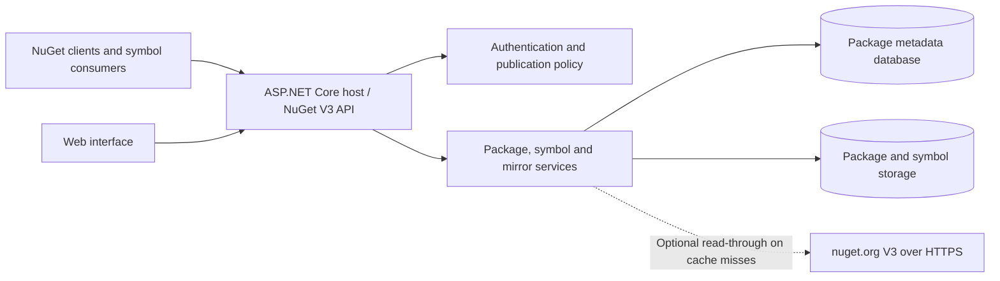

# BaGetter — Cenn0 fork

**Language:** **English** · [Deutsch](README.de.md)

[](https://github.com/Cenn0/BaGetter/actions/workflows/main.yml)
[](LICENSE)

A self-hosted **NuGet V3 package and symbol server** built with C# and ASP.NET Core. This is a community-maintained fork of [BaGetter](https://github.com/bagetter/BaGetter), originally based on [BaGet](https://github.com/loic-sharma/BaGet).

> **Project status:** This fork is under development. Build images and releases from the upstream project do **not** include fork-specific changes. The optional nuget.org mirror has passed selected live smoke tests, but full NuGet protocol compatibility, multi-instance operation and production readiness have not been established.

## Quick start

Requires the **.NET 10 SDK** compatible with [global.json](global.json).

```bash
git clone https://github.com/Cenn0/BaGetter.git
cd BaGetter
dotnet restore
dotnet run --project src/BaGetter --urls http://localhost:5000
```

Open [http://localhost:5000/](http://localhost:5000/) for the web interface. The NuGet V3 feed is at `http://localhost:5000/v3/index.json`.

### Docker

Build this fork's image rather than using an upstream image:

```bash
docker build -t bagetter-local:dev .
docker volume create bagetter-data
docker run --rm --name bagetter -p 127.0.0.1:5000:8080 \
  -v bagetter-data:/data bagetter-local:dev
```

The `/data` volume stores packages, symbols and SQLite data. The host port is intentionally bound to loopback; these commands are for **local evaluation**, not a production deployment.

## Capabilities

- NuGet V3 package feed with a web interface and symbol-serving endpoints.
- Configurable database and storage providers.
- Optional **read-through package caching** from nuget.org.
- .NET build, unit/integration tests and dedicated mirror smoke tests.

To enable read-through caching, set these environment variables in your local deployment:

```dotenv
Mirror__Enabled=true
Mirror__PackageSource=https://api.nuget.org/v3/index.json
```

The mirror can cache requested package content; it is **not** a fully transparent NuGet V3 reverse proxy. Search, autocomplete, offline metadata resolution and multi-replica correctness require separate validation. See [mirror behavior and live-test evidence](docs/MIRROR.md).

## Architecture and publication boundary



The default local Docker deployment uses **SQLite plus persistent filesystem storage**; other providers require their own operational qualification. For a new upload, immutable package files are written before a metadata record points to the committed storage revision. This provides an atomic **visibility boundary**, not an ACID transaction spanning database and files or object storage. Crashes may leave unreferenced files; missing committed data requires recovery or restoration. Shared multi-writer deployments are **not validated**. See [deployment and recovery](docs/OPERATIONS.md) and the [real nuget.org mirror acceptance scope](docs/MIRROR.md).

## Verification and release scope

The [Linux/Windows build matrix](.github/workflows/main.yml), [live mirror smoke](.github/workflows/mirror-smoke.yml), [Docker smoke](.github/workflows/docker-smoke.yml) and [PostgreSQL smoke](.github/workflows/postgresql-smoke.yml) exercise **different** scenarios; an individual green workflow does not certify all storage providers, NuGet V3 endpoints or clients. Consult the [release procedure](docs/RELEASING.md) before using a fork-owned tag or image. Upstream releases do not automatically contain this fork's changes.

## Development

```bash
dotnet restore
dotnet build --no-restore
dotnet test --no-build
```

[CI runs](https://github.com/Cenn0/BaGetter/actions) include build/test workflows and separate smoke tests. A passing individual run does not establish compatibility with every NuGet client or deployment.

## Security and operations

Default local settings are **not** a production security baseline. In particular, an empty `ApiKey` is not proof that publishing is securely restricted. Before exposing a feed, validate authentication and publishing authorization, terminate HTTPS at a trusted proxy, restrict network access, set resource limits and test backups of **both** database and package storage. Do not assume distributed transactions across the database and file/object storage.

- [Deployment, configuration, backup and recovery](docs/OPERATIONS.md)
- [Mirror setup and limitations](docs/MIRROR.md)
- [Roadmap and release criteria](ROADMAP.md)
- [Contributing](CONTRIBUTING.md)

Report security-sensitive issues privately where feasible; do not post tokens or deployment secrets in public issues.

## License

[MIT](LICENSE). Attribution to the original [BaGetter](https://github.com/bagetter/BaGetter) and [BaGet](https://github.com/loic-sharma/BaGet) projects is retained. This fork does not imply upstream endorsement or commercial support.
